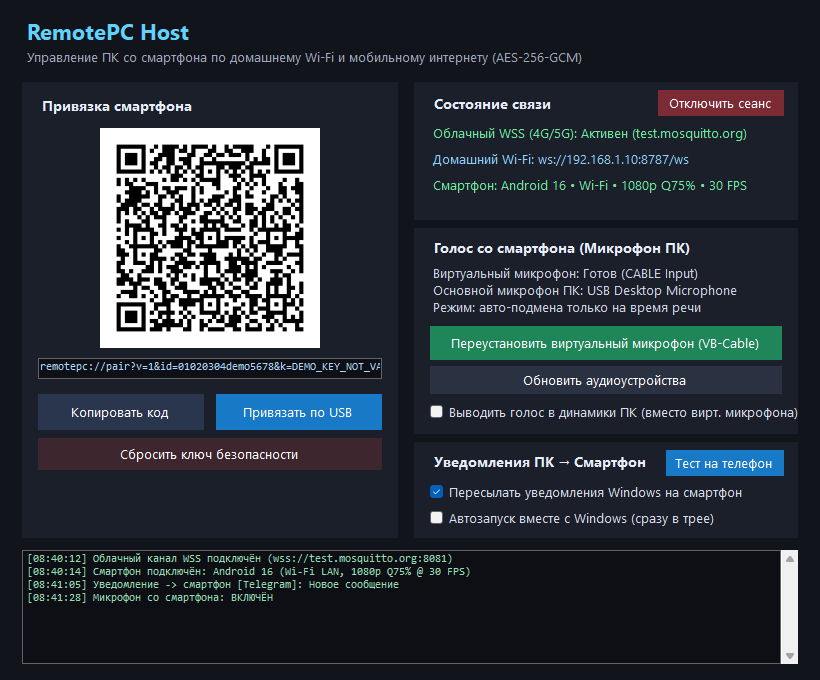
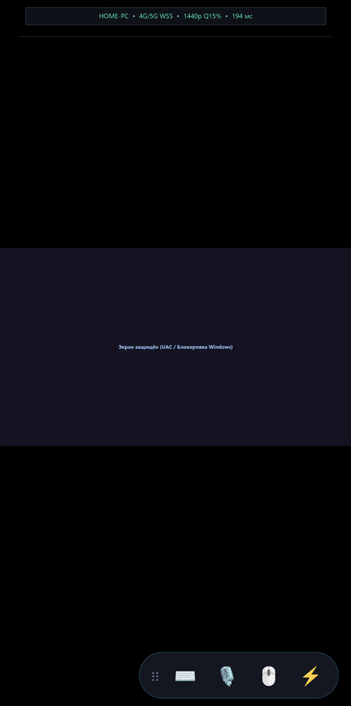
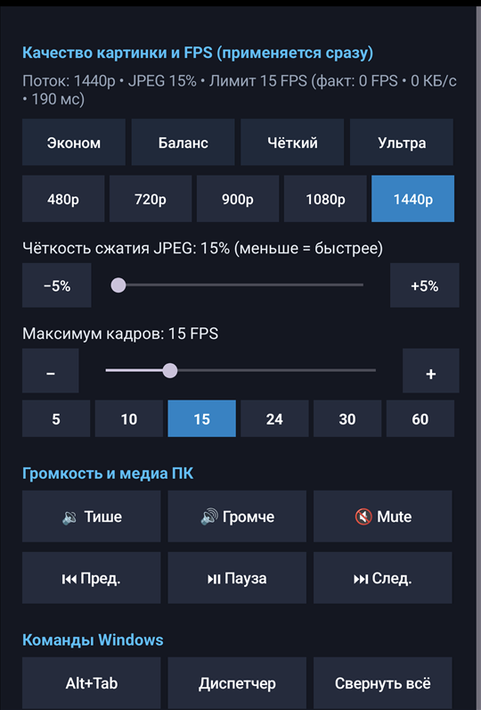

# RemotePC

[](https://github.com/DomenicoCano/RemotePC/releases/latest/download/RemotePcHost.exe)
[](https://github.com/DomenicoCano/RemotePC/releases/latest/download/RemotePC.apk)

Связка из Windows-сервера (`C# / WinForms / .NET 10`) и нативного Android-клиента (`Kotlin`) для управления домашним ПК со смартфона по домашнему Wi-Fi (`< 5 мс`) и через мобильный интернет `4G/5G` без белого IP и настройки роутера. Весь трафик шифруется `AES-256-GCM`; используются библиотеки [NAudio](https://github.com/naudio/NAudio), [QRCoder](https://github.com/codebude/QRCoder), [OkHttp](https://square.github.io/okhttp/), [ML Kit Barcode Scanning](https://developers.google.com/ml-kit/vision/barcode-scanning) и опциональный драйвер [VB-Audio Virtual Cable](https://vb-audio.com/Cable/) для передачи голоса в микрофон ПК.

<p align="center">
  
</p>

<table align="center">
  <tr>
    <td align="center"></td>
    <td align="center"></td>
  </tr>
</table>

## Установка

1. **ПК (Windows 10/11 x64):** скачайте [RemotePcHost.exe](https://github.com/DomenicoCano/RemotePC/releases/latest/download/RemotePcHost.exe) (автономная однофайловая сборка, `.NET` ставить не требуется) и запустите — при первом запуске программа сама создаст 256-битный ключ и QR-код в `%APPDATA%\RemotePcHost\config.json`.
2. **Смартфон (Android 8–16):** скачайте и установите [RemotePC.apk](https://github.com/DomenicoCano/RemotePC/releases/latest/download/RemotePC.apk), разрешите установку из этого источника и уведомления.
3. **Привязка:** в приложении нажмите **«Сканировать QR»** и наведите камеру на QR-код в окне `RemotePcHost.exe` (либо нажмите **«Привязать по USB»** на ПК при включённой отладке по USB).
4. **Фон и голос (опционально):** для доставки уведомлений с ПК при выключенном экране нажмите на главном экране приложения кнопку **«Отключить экономию батареи для фона»**; для передачи голоса со смартфона в программы ПК нажмите в окне ПК **«Установить виртуальный микрофон (VB-Cable)»**.
5. **Удаление:** на Windows закройте программу в трее, снимите галочку автозапуска (если включали) и удалите `RemotePcHost.exe` вместе с `%APPDATA%\RemotePcHost`; на Android удалите приложение обычным способом.

## Что умеет

- **Экран ПК на телефоне:** передача по локальному WebSocket (`8787`) и облачному MQTT-over-WSS со сквозным шифрованием `AES-256-GCM`, дельта-обновлениями экрана (`VideoTile`), выбором монитора, пресетами и ручной настройкой разрешения (`480p–1440p`), качества JPEG (`15–95%`) и кадровой частоты (`1–60 FPS`), зумом щипком до `5×`.
- **Управление и умный ввод:** режимы «Тачпад» (жесты прокрутки и перетаскивания, слежение при зуме) и «Прямое касание», выезд клавиатуры при фокусе в текстовом поле (`ime_hint`), передача кириллицы/латиницы и свайп-ввода независимо от раскладки Windows (`KEYEVENTF_UNICODE`), панель хоткеев (`Ctrl`, `Alt`, `Win`, `Esc`, стрелки) и двусторонний буфер обмена.
- **Микрофон со смартфона в ПК:** сжатие голоса (`16 кГц` моно `IMA-ADPCM`), авто-подмена микрофона по умолчанию на `VB-Audio Virtual Cable` через COM `IPolicyConfig` на время речи с гарантированным возвратом основного микрофона, оповещение о запросе микрофона программами ПК.
- **Уведомления Windows на телефон (даже с выключенным экраном):** чтение новых toast-уведомлений из `wpndatabase.db` через системную `winsqlite3.dll`, доставка по выделенному лёгкому каналу (`notify_h2c` + Wi-Fi UDP) без запуска видеопотока, досылка до `30` пропущенных сообщений (`notif_sync`) и бессрочная служба Android `specialUse` с `PARTIAL_WAKE_LOCK` и автозапуском после перезагрузки телефона.

## Что проверено

- **Windows Host (`RemotePcHost.exe`, `v1.1.0`, автономная сборка x64):** пройдено `14/14` встроенных проверок `--selftest` (`AES-256-GCM`, анти-повтор с 8 параллельными клиентскими солями, захват `2560×1440`, `VideoTile`, `IMA-ADPCM`, WSS-брокер, парсер XML `<toast>` и чтение `wpndatabase.db` через `winsqlite3.dll`).
- **Android Release APK (`RemotePC.apk`, `v1.1.0`):** релизная сборка `assembleRelease` подписана схемой APK v2/v3 (`CN=RemotePC`, проверка `apksigner verify` без ошибок).
- **Реальное устройство (`Android 16`, Xiaomi):** проверено подключение и управление поверх `4G+` WSS и локального Wi-Fi, меню настройки качества/FPS/буфера обмена, а также сквозная доставка реального WinRT Toast-уведомления Windows в спящем режиме с выключенным экраном (`mWakefulness=Dozing` → уведомление с кнопкой «Открыть ПК» подтверждено в `dumpsys notification`).
- **Приватность:** исходный код, `RemotePC.apk` и `RemotePcHost.exe` проверены скриптом `scan_privacy.py` на отсутствие личных путей сборки, учётных записей и ключей.

## Известные ограничения

- **Предупреждения ОС:** у `.exe` нет коммерческой цифровой подписи издателя (Windows SmartScreen может показать запрос *«Подробнее → Выполнить в любом случае»*), а у `.apk` используется собственная подпись разработчика (Google Play Protect может попросить однократное подтверждение при первой установке).
- **Односторонняя передача голоса:** звук идёт **со смартфона в микрофон/колонки ПК**; системный звук самого компьютера обратно на телефон не транслируется. Для работы виртуального микрофона требуется установка стороннего драйвера VB-Cable.
- **Аппаратное покрытие:** живая проверка Android-клиента выполнялась на смартфоне Xiaomi (`Android 16`, HyperOS); на других прошивках (Samsung One UI, Pixel и др.) поведение фоновой службы при выключенном экране может зависеть от системных настроек энергосбережения.
- Если столкнётесь с ошибкой, опишите её в [Issues](https://github.com/DomenicoCano/RemotePC/issues).

## Сборка из исходников

> [!NOTE]
> Готовые бинарные файлы публикуются только в [Releases](https://github.com/DomenicoCano/RemotePC/releases) — в самом дереве репозитория `.exe`, `.apk` и ключи подписи не хранятся.

- **Windows Host (`.NET 10 SDK`):**
  ```powershell
  dotnet publish pc-host\RemotePcHost.csproj -c Release -r win-x64 --self-contained true -p:PublishSingleFile=true -p:EnableCompressionInSingleFile=true -o pc-host\publish-portable
  ```
- **Android APK (`JDK 21`, `Android SDK 35`, `Gradle 9.6`):**
  1. Укажите путь к SDK в `android-app\local.properties` (`sdk.dir=...`) и при необходимости настройки ключа подписи в `android-app\keystore.properties` (`storeFile`, `storePassword`, `keyAlias`, `keyPassword`).
  2. Если путь к папке содержит кириллицу или не-ASCII символы, в `android-app\gradle.properties` уже добавлено `android.overridePathCheck=true`.
  3. Соберите APK:
     ```powershell
     cd android-app
     gradle assembleRelease
     ```

## Контрольные суммы (SHA-256)

| Файл | Назначение | SHA-256 |
| --- | --- | --- |
| `RemotePcHost.exe` | Сервер для Windows 10/11 (x64, автономный) | `72fef0ec78148c4e39327238728ad1c61b1c7520228a54298316066438204200` |
| `RemotePC.apk` | Приложение для Android 8–16 (подписанный release) | `654e4d2e6856e1ed87cc6eb9505cc8b5aea572b277b7a4598248a04d207fdac6` |

## Состав репозитория

| Путь | Назначение |
| --- | --- |
| `pc-host/` | Исходный код Windows-сервера (`WinForms`, захват экрана, ввод, `VB-Cable`, перехват уведомлений, локальный WS и облачный MQTT-WSS) |
| `android-app/` | Исходный код Android-приложения (сеанс рабочего стола, клавиатура, микрофон, фоновый мост уведомлений `PcNotificationService`) |
| `docs/` | Скриншоты интерфейса для `README.md` |
| `.gitignore` | Исключение бинарных артефактов, кешей сборки и ключей подписи |

## Важно

- Проект предназначен исключительно для удалённого доступа к собственным компьютерам с ведома владельца.
- Облачный транспорт по умолчанию использует публичные тестовые MQTT-брокеры (`test.mosquitto.org`, `broker.emqx.io`, `broker.hivemq.com`, `mqtt.eclipseprojects.io`) исключительно как зашифрованный канал передачи (`AES-256-GCM`) — содержимое экрана, ввода, голоса и уведомлений расшифровывается только на ваших устройствах.
